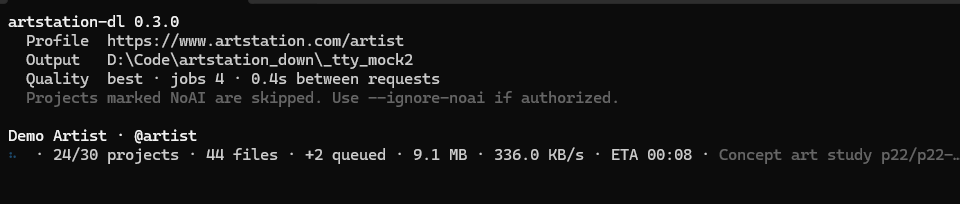
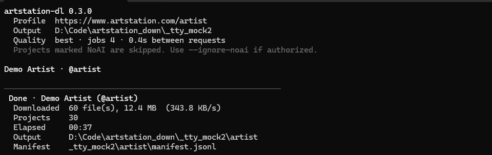
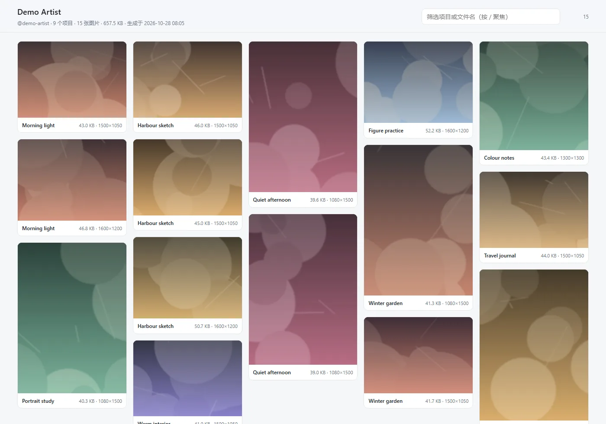

# ArtStation Local Downloader

一个本地运行的 ArtStation 公开作品集图片下载器。输入用户名或主页链接后，程序会枚举公开 Portfolio 项目，下载其中的图片，并保存可续跑的状态和清单。

## 特性

**抓取与画质**

- 支持用户名、`www.artstation.com/<username>` 和自定义 ArtStation 社区域名；
- 自动分页读取公开 Portfolio 项目和多图作品；
- 图片优先尝试 `8k → 4k → large → medium → small` CDN 版本，自动回退到实际可取得的最高画质；
- 默认跳过明确标记为 `NoAI` 的项目；默认不下载视频、Marmoset viewer、外部嵌入、头像和背景图。

**速度**

- 连接复用（keep-alive）：同一个站的 TCP/TLS 只握手一次，不再为每张图重新建连；
- 并发传输：`--jobs`（默认 3）让下载互相重叠，`--delay` 仍是**全局**请求间隔，请求频率不因并发而提高；
- 项目缓存：作品集项目的 `updated_at` 未变化时不再请求详情页，第二次运行几乎不产生网络请求；
- SQLite 状态库：每张图一次小事务写入，取代旧版「每下载一张就重写整个 state.json」的 O(n²) 写盘。

**稳定**

- `.part` 临时文件 + HTTP Range 断点续传，原子替换落地；
- `Ctrl+C` 优雅退出：等在途文件收尾、保存进度、打印续跑提示，再次按下才强制中断；
- 单个作品集解析失败只跳过该项目，不会中断整次抓取；网络抖动/5xx/429 自动退避重试；
- 状态库损坏会自动备份并重建；意外中断不会丢失已完成记录；
- 图片文件头校验、单文件大小上限、磁盘写入失败可读提示、Windows 长路径自动缩短；
- HTTP 遇到 401/403 时，可自动切换到本机有界面的 Chrome/Edge 会话继续（`--no-browser` 可关闭）。

**浏览与维护**

- 一键生成本地 HTML 画廊（`--gallery`）：瀑布流缩略图、项目名/文件名筛选、点击看原图，单文件、离线可用；
- `--gallery-only` 可离线重建画廊，不联网；
- `--verify` 离线校验已保存文件的大小与 SHA-256，发现损坏自动标记为待重下；
- 下载目录或状态文件来自别的机器时，会按路径尾部重新锚定已下载图片，不会重新下载，并自动把记录修正为相对路径。

**交互**

- 单行实时进度：项目数、文件数、已下载体积、速率、ETA、当前文件；
- 颜色与图标自动降级：不支持 UTF-8 的终端（例如中文代码页的管道输出）自动使用纯 ASCII；
- `--quiet` 只留错误与总结；非 TTY 环境逐行输出，便于重定向到日志；
- 结束时打印汇总：下载/已存在/跳过/失败、体积、耗时、输出路径、清单路径、失败原因；
- 退出码固定：`0` 全部处理成功、`1` 有文件失败（重跑即重试）、`2` 致命错误、`130` 被中断。

## 界面预览

下载进行中——实时进度、速率、队列、ETA 与当前文件：



结束后的汇总——下载量与平均速率、耗时、输出路径、清单路径、失败清单：



`--gallery` 生成的本地画廊（截图使用合成示意数据；支持筛选、深浅色、离线打开）：



## 安装

需要 Python 3.10 或更新版本。建议使用虚拟环境：

```bash
python -m venv .venv
```

Windows PowerShell：

```powershell
.\.venv\Scripts\Activate.ps1
python -m pip install -e .
```

Linux/macOS：

```bash
source .venv/bin/activate
python -m pip install -e .
```

浏览器 fallback 默认寻找已安装的 Chrome 或 Edge。如果系统没有这两个浏览器，可以安装 Playwright 管理的 Chromium：

```bash
python -m playwright install chromium
```

> Playwright 只在 HTTP 被挑战、需要切换到浏览器会话时才会用到；日常下载走内置的 HTTP 客户端。

## 使用

给出用户名或主页链接即可：

```bash
python -m artstation_downloader kyz --output downloads
python -m artstation_downloader https://www.artstation.com/kyz --output downloads
```

也可以使用安装后的命令：

```bash
artstation-dl kyz -o downloads
```

常用选项：

```text
--quality best|8k|4k|large|medium|small   目标画质，默认 best
-j, --jobs N                              并发下载数，1-16，默认 3
--delay SECONDS                           任意两次请求的最小间隔，默认 1.0
--max-projects N / --max-files N          只处理前 N 个项目 / 前 N 张图
--timeout / --retries                     单请求超时与瞬时故障重试次数
--max-file-size BYTES                     单文件大小上限，默认 250 MiB
--cookie-file FILE                        可选的本机 Netscape Cookie 导出
--proxy URL                               显式 HTTP 代理（默认读取 HTTPS_PROXY / NO_PROXY）
--browser-path EXE / --no-browser         指定或禁用浏览器 fallback
--overwrite                               重新下载已保存的文件
--ignore-noai                             不跳过 NoAI 项目（仅在你有权保存时使用）
--dry-run                                 只演示，不写任何文件
--gallery                                 下载结束后生成本地画廊 index.html
--gallery-only                            用已保存状态离线重建画廊
--verify                                  离线校验已保存文件的大小与校验和
-q, --quiet / --no-color / -v, --verbose  输出控制
```

常用组合：

```bash
artstation-dl kyz --quality 4k --jobs 4 --delay 0.5   # 更快，仍是低频
artstation-dl kyz --jobs 1 --delay 2                  # 最保守
artstation-dl kyz --dry-run                           # 先看会下载什么
artstation-dl kyz --proxy http://127.0.0.1:7890       # 走本地代理
artstation-dl kyz --gallery                           # 下载并生成本地画廊
artstation-dl kyz --gallery-only                      # 只重建画廊（不联网）
artstation-dl kyz --verify                            # 校验文件是否损坏/缺失
```

其中 `best` 会按 `8k → 4k → large → medium → small` 顺序尝试。这里的 `8k/4k` 是 ArtStation 公开 CDN 提供的版本，不保证等于作者未压缩的原始上传文件；如果平台只公开 `4k` 或 `large`，程序会使用实际可取得的最高版本。

## 输出结构

```text
downloads/
├── state.sqlite3            # 断点续跑状态 + 项目缓存
└── kyz/
    ├── manifest.jsonl       # 每行一条便携记录（相对路径、大小、SHA-256、尺寸）
    ├── index.html           # --gallery 生成的本地画廊（可选）
    └── 0001_Project title/
        └── 001_image.jpg
```

`manifest.jsonl` 中的路径相对于输出目录保存，便于把整个下载目录搬到另一台机器。重复运行会跳过已经校验完成的文件；中断后直接重新执行同一条命令即可续跑。

## 本地浏览与校验

**画廊**：加上 `--gallery` 后，程序会在 `<输出>/<用户名>/index.html` 生成一个单文件画廊，内联 CSS/JS、不引用任何外部资源，双击即可离线浏览：

- 瀑布流缩略图按项目顺序排列，标题、体积、分辨率一目了然；
- 顶部搜索框可按项目名或文件名过滤（按 `/` 快速聚焦，`Esc` 清空）；
- 浅色/深色主题跟随系统；点击卡片在新标签页打开原图；
- 磁盘上缺失的文件会计入页眉的「N 个文件缺失」，不会被渲染成坏图。

搬动过目录或从别的机器拷来状态文件时，画廊和下载都按路径尾部重新锚定本地文件，不会整库重下。想在不联网的情况下重建画廊，用 `--gallery-only`。

**校验**：`--verify` 会逐条比对已保存文件的大小和 SHA-256：

- 缺失的文件只报告，不改状态（重跑下载会自动补）；
- 大小或校验和不对的文件会被标记为 `failed`，重跑同一条命令即可重新下载；
- 全程不联网，只读磁盘；`--verify --dry-run` 只报告、不修改状态。

## 速度与请求礼貌

`--delay` 控制的是**任意两次请求之间的最小间隔**（全局），`--jobs` 只让传输互相重叠，因此提高并发不会提高请求频率。

| 场景 | 建议 |
| --- | --- |
| 默认 | `--jobs 3 --delay 1.0` |
| 网速好、希望更快 | `--jobs 4~6 --delay 0.4` |
| 严格要求低频 | `--jobs 1 --delay 2` |
| 只想补全失败文件 | 直接重跑同一命令（失败项会自动重试） |

本项目实测（本地 mock，120 个项目）：

- 首次运行 0.27s（含 240 次详情/图片请求），二次运行 0.04s（0 次详情请求，项目缓存命中）；
- 800 条下载记录的状态写入：旧版 JSON 3.52s，SQLite 0.039s（约 89 倍）；
- 真实站点上 `kyz` 前 10 个作品（5.8 MB）：首次约 12s，二次（全部命中缓存）约 2.4s。

## 断点续跑与重试

- 每个文件先写 `<name>.part`，校验文件头与实际大小后原子改名，不会留下半张图；
- 中断（`Ctrl+C`、关机、网络断开）后重新执行同一条命令即可，`.part` 会通过 Range 续传；
- 失败的文件记录在 `state.sqlite3` 与 `manifest.jsonl` 中，并汇总在结尾的失败清单里；重跑同一条命令只会重试这些文件；
- `--dry-run` 不写图片、不写清单、不写状态，适合先确认范围。

## 访问挑战与 Cookie

程序首先使用低频 HTTP 请求；遇到 ArtStation 的 401/403，会提示后自动打开一个正常的有界面浏览器并继续读取公开页面。若浏览器本身也遇到 CAPTCHA、Cloudflare challenge 或登录墙，程序会停止，不破解 CAPTCHA、不伪造指纹、不轮换代理，也不高并发重试。

如确实需要已授权的登录态，可通过本地 Netscape 格式 Cookie 文件传入：

```bash
python -m artstation_downloader kyz --cookie-file cookies.txt
```

Cookie 文件等同于登录凭据，只应保存在本机；程序只接受 ArtStation 域名 Cookie，不会打印 Cookie 值。Cookie 文件已被 `.gitignore` 排除。

## 代理

默认读取环境变量 `HTTPS_PROXY` / `HTTP_PROXY` / `ALL_PROXY`，并遵守 `NO_PROXY`；也可以用 `--proxy` 显式指定：

```bash
python -m artstation_downloader kyz --proxy http://127.0.0.1:7890
```

只支持 HTTP/HTTPS 代理（不支持 SOCKS）；代理凭据可写在 URL 里，程序不会打印它。

## 故障排查

| 现象 | 处理 |
| --- | --- |
| `Error: ArtStation returned an access challenge` | 在打开的浏览器里完成验证后重跑；或稍后再试，不要提高并发 |
| `cannot write to output folder` | 换一个有写权限的目录，或关闭占用该目录的程序 |
| `low disk space` 警告 | 清理磁盘，或用 `--max-file-size` 限制单文件 |
| 终端里出现 `??` / 乱码 | 说明当前输出被重定向到非 UTF-8 管道，程序已自动降级为 ASCII；也可以设置 `PYTHONIOENCODING=utf-8` |
| 部分文件失败 | 看结尾「Failed items」，直接重跑同一条命令 |
| 图片打开是坏的/体积不对 | 运行 `--verify` 校验，损坏文件会被标记并在下次运行时重下 |
| 想确认会下载什么 | 加 `--dry-run` |
| 想浏览已下载的作品 | 加 `--gallery`，或 `--gallery-only` 离线重建 |

## 使用边界

本项目适用于你有权保存的公开作品，仅处理 ArtStation 站内公开 Portfolio。请遵守 ArtStation 条款、作者版权和项目中的 NoAI 标记，不要将下载内容用于未经授权的数据集或再分发。

## 开发

安装开发依赖并运行检查：

```bash
python -m pip install -e ".[dev]"
ruff check .
python -m unittest discover -s tests -v
python -m build
```

测试覆盖：URL 归一化、画质回退、Cookie 解析、文件名/长路径、SQLite 状态与迁移、HTTP 会话（keep-alive/gzip/重定向/Cookie/代理）、并发下载、取消、项目缓存、HTML 画廊、完整性校验，以及基于本地 mock 服务的完整 CLI 端到端流程（不访问真实 ArtStation）。

调试时可以指向 localhost 上的 mock 服务：

```bash
ARTSTATION_API_BASE=http://127.0.0.1:8000 python -m artstation_downloader kyz
```

GitHub Actions 会在 Python 3.10、3.11 和 3.12 上执行 lint、单元测试和构建。网络访问和真实 ArtStation 下载不作为 CI 的必需条件，以避免外部站点波动导致构建不稳定。

## 版本记录

**0.3.0**

- 新增本地 HTML 画廊（`--gallery` / `--gallery-only`）：瀑布流、按项目/文件名筛选、深浅色主题、离线可用；
- 新增离线完整性校验（`--verify`）：比对大小与 SHA-256，损坏文件自动标记重下；
- 下载目录整体搬移或状态来自其他机器时，按路径尾部重新锚定并自动修正为相对路径；
- 新增实时进度、彩色输出、ASCII 降级、结束汇总与失败清单；
- 新增并发下载（`--jobs`）、连接复用与 gzip；
- 新增 SQLite 状态库（自动导入旧 `state.json`）与作品集项目缓存；
- 新增 `Ctrl+C` 优雅退出、断点续跑提示、损坏状态库自愈；
- 新增 `--proxy`、`--no-browser`、`--quiet`、`--no-color`、`--dry-run` 零写入；
- 修复：长路径/超长标题、原图扩展名与候选画质不一致时的临时文件处理、Windows 控制台符号乱码。

**0.2.0**：首个公开版本。

## License

MIT，详见 [LICENSE](LICENSE)。
